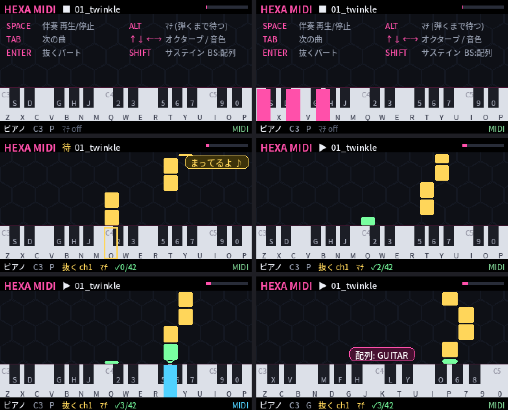

# HEXA MIDI v0.1

CardputerZero ＋ M5Stack **Unit MIDI (U187)** で、伴奏を流しながら弾くアプリ。
音は Unit MIDI の中の音源 (SAM2695, GM 128音色) から出る。ﾊﾆｶﾑ画面は HEXA CLIP と同じ流儀 (強調色はﾋﾟﾝｸ)。



## できること
- **CPZ のｷｰﾎﾞｰﾄﾞが鍵盤**: PIANO 配列 (DAW と同じ Z〜M / Q〜P の2段) と GUITAR 配列 (段ごとに4度上)
- **伴奏を流す**: `songs/` か `~/midi/` の `.mid` を再生。上から音が降ってくる
- **ﾒﾛﾃﾞｨ抜き**: ENTER で抜くﾊﾟｰﾄを選ぶ (ﾒﾛﾃﾞｨらしい ch が最初に出る)。抜いたﾊﾟｰﾄが黄色で降ってきて、弾けた音は緑になる。自分の音色もそのﾊﾟｰﾄに合わせる
- **ﾏﾁ (ALT)**: 抜いたﾊﾟｰﾄの次の音を弾くまで伴奏が待つ。ｵｸﾀｰﾌﾞ違いでも正解。最後に ✓正解数 を表示
- **本物の鍵盤もつながる**: Unit MIDI の IN に電子ﾋﾟｱﾉ等の MIDI OUT をつなぐと、CPZ 経由で SAM2695 が鳴り、ﾏﾁの答えにもなる (水色で表示)

## はじめる
```sh
cd ~/hexamidi && sh install.sh     # sudo は付けない
sudo reboot                        # 初回だけ (UART・権限・ｱｲｺﾝの反映)
hexamidi --probe                   # ドミソが鳴れば OK
```
ﾗﾝﾁｬｰの「HEXA MIDI」から起動。ｺﾏﾝﾄﾞなら `hexamidi`。

### つなぎ方
- Unit MIDI を **右側の Grove** に付属ｹｰﾌﾞﾙでつなぐ (Grove は初期状態で UART = GPIO14 TX / GPIO15 RX)
- **Settings > ExtPort で Grove の 5V を ON** (初期状態は OFF。Grove は UART のまま)
- Unit MIDI のｽｲｯﾁ
  - **Bypass**: 外の鍵盤を使う時はこちら。IN → CPZ (→ SAM2695 で鳴らす) / IN → OUT 直結
  - Separate: CPZ の音が SAM2695 と DIN OUT の両方に出る (外の音源も鳴らしたい時)。この時 CPZ の RX は浮くので、変な音が出たら CTRL で IN をｵﾌ
- 音は Unit MIDI の 3.5mm ｼﾞｬｯｸから (ｲﾔﾎﾝ/ｱﾝﾌﾟ付きｽﾋﾟｰｶｰ)

## ｷｰ
| ｷｰ | 動き |
|---|---|
| PIANO: `Z S X D C V G B H N J M` | C〜B (S D G H J が黒鍵) |
| PIANO: `Q 2 W 3 E R 5 T 6 Y 7 U I 9 O 0 P` | 1ｵｸﾀｰﾌﾞ上の C〜E |
| GUITAR: 下の段から `Z…` `A…` `Q…` `1…` | 1段上がるごとに 4度上、右へ半音ずつ |
| SHIFT (押している間) | ｻｽﾃｲﾝ |
| ↑↓ (fn+F / fn+X) | ｵｸﾀｰﾌﾞ |
| ←→ (fn+Z / fn+C) | 音色 (ﾋﾟｱﾉ, ｴﾚﾋﾟ, ﾋﾞﾌﾞﾗﾌｫﾝ, …, ｽﾁｰﾙﾄﾞﾗﾑ) |
| SPACE | 伴奏 再生 / 一時停止 |
| TAB | 次の曲 |
| ENTER | 抜くﾊﾟｰﾄ (なし → ﾒﾛﾃﾞｨ → 他の ch …) |
| ALT | ﾏﾁ ON/OFF (ON にすると抜くﾊﾟｰﾄも自動で選ぶ) |
| CTRL | MIDI IN のｽﾙｰ ON/OFF |
| BS | 配列 PIANO ↔ GUITAR |
| ESC | 終了 |

## 曲
- `songs/` (ｱﾌﾟﾘの横) と `~/midi/` の `.mid` を名前順に読む。PC から `scp 曲.mid ユーザー@CPZ:~/midi/`
- ﾃﾞﾓ: `01_twinkle.mid` (きらきら星) / `02_joy.mid` (歓喜の歌)。どちらもﾊﾟﾌﾞﾘｯｸﾄﾞﾒｲﾝの曲を `make_demo.py` で生成
- 自分の演奏は **ch16** で鳴らすので、ch16 を使う曲だとぶつかる

## 仕組み
- `hexamidi.py` … 画面・鍵盤・伴奏の再生 (別ｽﾚｯﾄﾞ)・SMF の読み込み (mido 等は使わず自前)
- UART は `/dev/serial0` を 31250bps で開く (`--port` か `HEXAMIDI_PORT` で変更可)
- `install.sh` は `enable_uart=1` を config.txt に足し、cmdline.txt からｼﾘｱﾙｺﾝｿｰﾙを外す (元は `.hexamidi.bak`)

## 困った時
- `hexamidi --probe` … UART の設定、ﾃｽﾄ音、MIDI IN の受信を確認
- 鳴らない: Grove の 5V が ON か / ｽｲｯﾁの位置 / `ls -l /dev/serial0` / `id` に dialout があるか
- 画面が戻らない: `sudo pkill -CONT -f APPLaunch`
- PC で画面だけ確認: `python3 hexamidi.py --sim /tmp/sim`

## 実機で確かめること
- `/dev/serial0` が 31250bps で開けるか (mini UART は enable_uart=1 でｸﾛｯｸ固定 → 割り切れる)
- Grove のｹｰﾌﾞﾙ向き (黄 = CPZ TX → Unit の RX のはず)
- ｷｰﾎﾞｰﾄﾞの同時押し (和音) が何個まで取れるか
- 鳴るまでの遅れ (気になるなら画面の更新を減らす)
